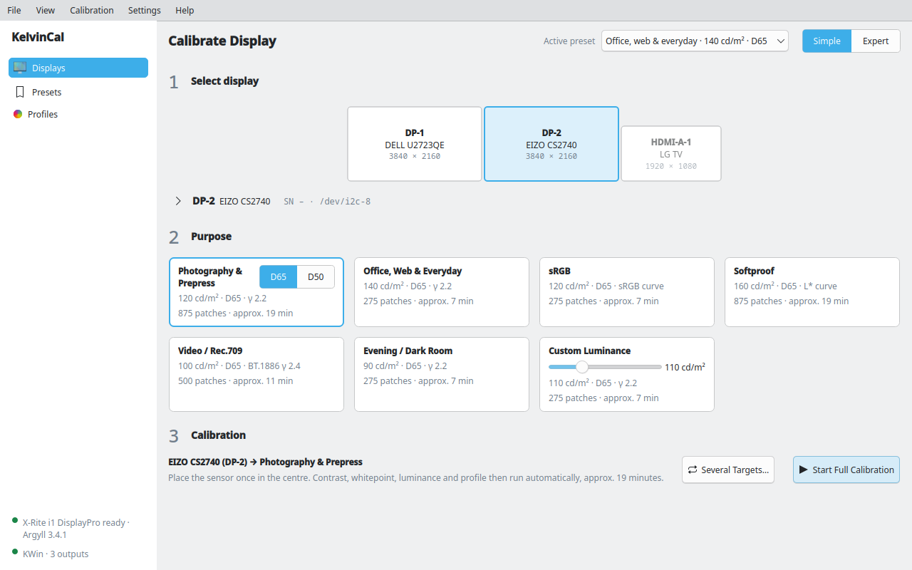
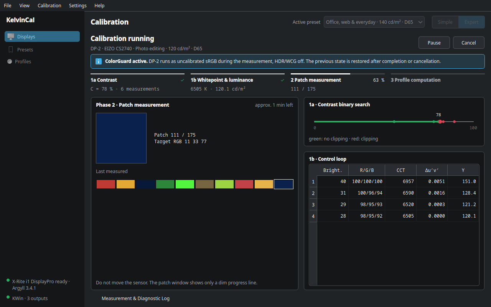
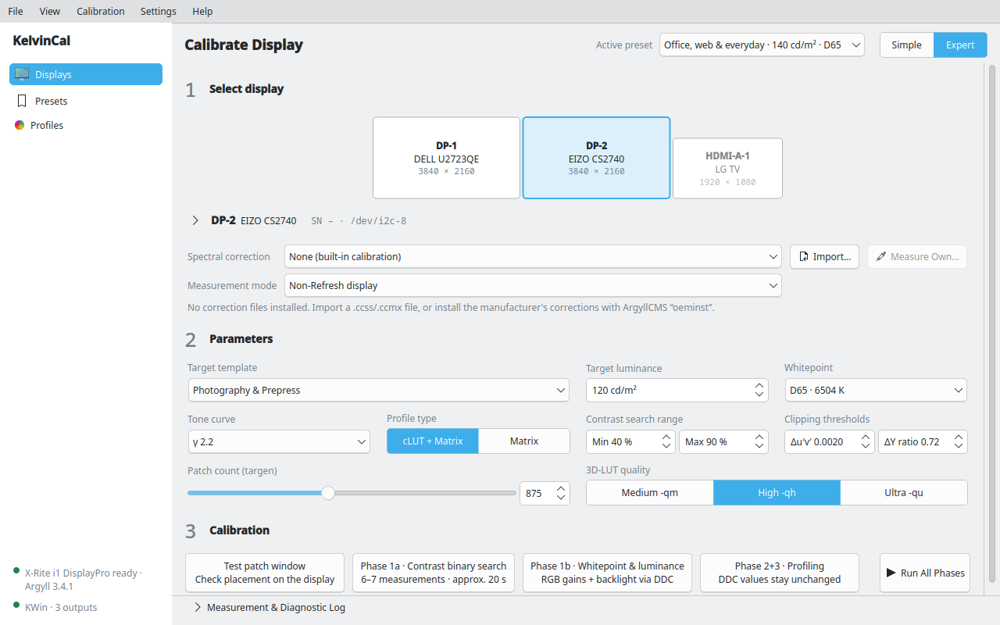
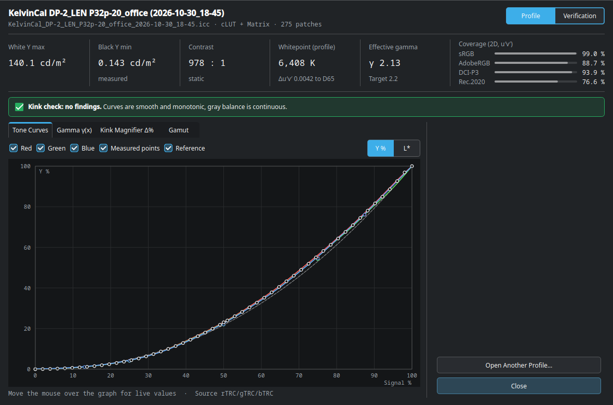
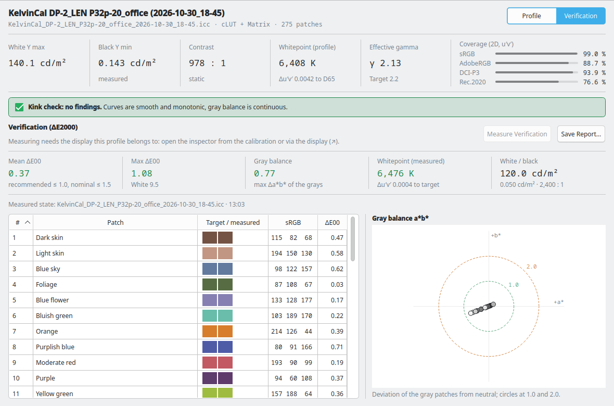
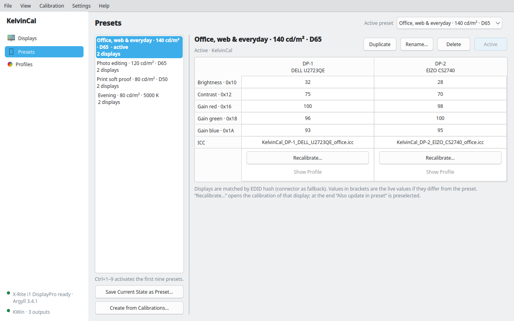
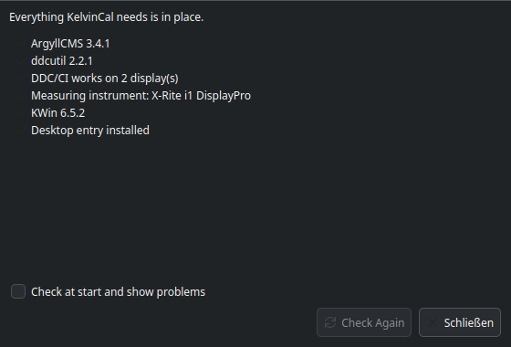

<p align="center"></p>

# KelvinCal

**Display calibration for KDE Plasma on Wayland: the display's own hardware is set to the target white point and
brightness over DDC/CI, then an ICC profile is measured with ArgyllCMS and activated in KWin. Presets switch all
displays at once, from the app, the panel or the command line.**



## What it does

- **Hardware first.** KelvinCal finds the highest contrast setting that does not clip and adjusts the RGB gains and
  brightness of the display itself (DDC/CI) until white point and luminance match the target. The ICC profile then
  only has to correct what the hardware cannot, so colours stay accurate even in applications without colour
  management.
- **One run, sensor placed once.** Contrast search, white point/luminance control loop, patch measurement and profile
  computation run in one go (about 7–20 minutes). Several targets (e.g. office, photo, evening) can be calibrated in
  one batch.
- **Made for Wayland and KWin.** The patch window opens fullscreen on the right display, KWin's colour management is
  switched to uncalibrated sRGB during the measurement and restored afterwards, and the new profile is activated
  through KWin. Screen locking is inhibited while measuring.
- **Check before you keep it.** The inspector shows tone curves, effective gamma, gamut coverage and a kink check, lets
  you switch live between new profile, previous profile and uncalibrated, and verifies the result with ΔE2000
  test patches (report as HTML).
- **Presets.** Brightness, contrast, RGB gains and ICC profile of all displays are stored together and switched in
  about a quarter of a second: in the app (Ctrl+1–9), with the Plasma panel widget or with `kelvincal-cli`.
  KelvinCal notices when a display no longer matches the active preset (e.g. changed in its on-screen menu).
- **Plasma integration.** Breeze style, follows the system colour scheme (or any installed one), notifications,
  D-Bus interface, single instance.
- **Colorimeter corrections.** Spectral corrections (.ccss) and matrices (.ccmx) per display, including your own,
  measured with a spectrometer (i1 Pro, ColorMunki).
- **Safe to interrupt.** Cancelling, quitting, logging out or even a crash leave no display in measurement state:
  the previous state is restored, or offered for restoring at the next start.

| | |
|---|---|
|  |  |
|  |  |
|  |  |

## Status

Beta. Developed and tested on Fedora 44 with KDE Plasma 6 (KWin 6.7), an X-Rite i1 Display Pro (colorimeter),
an i1 Pro (spectrometer) and Lenovo ThinkVision displays. Other instruments supported by ArgyllCMS and displays with
DDC/CI should work; reports are welcome.

Displays without DDC/CI (e.g. laptop panels) can be profiled, but their hardware cannot be adjusted.

## Requirements

- KDE Plasma 6 on Wayland (KWin, `kscreen-doctor`)
- Python ≥ 3.11 and PySide6 ≥ 6.6
- [ArgyllCMS](https://www.argyllcms.com/) for measuring
- [ddcutil](https://www.ddcutil.com/) and read/write access to `/dev/i2c-*` for DDC/CI
- A measuring instrument supported by ArgyllCMS

| | Fedora | Debian / Ubuntu | Arch |
|---|---|---|---|
| Packages | `sudo dnf install python3-pyside6 argyllcms ddcutil kscreen` | `sudo apt install python3-pyside6.qtwidgets python3-pyside6.qtdbus argyll ddcutil kscreen` | `sudo pacman -S pyside6 argyllcms ddcutil kscreen` |

## Installation

Packages are planned. Until then KelvinCal runs directly from a checkout:

```bash
git clone https://github.com/colorcube/kelvincal.git
cd kelvincal
./bin/install-plasmoid     # links kelvincal/kelvincal-cli into ~/.local/bin, installs desktop entry,
                           # icons, notifications and the panel widget (bin/install-desktop: without the widget)
kelvincal-cli check        # checks ArgyllCMS, ddcutil, I²C and USB access, KWin
```

The setup check (also *Help → Check Setup…* in the app) names every missing piece together with the command that
fixes it, e.g. access to the I²C buses or a udev rule for the instrument.

## Usage

Start **KelvinCal** from the application menu (or `kelvincal`).

1. **Simple mode:** select the display, choose the purpose (photo, office, sRGB, soft proof, video, evening or your
   own brightness) and start the full calibration. Place the sensor in the crosshair when asked; the rest runs by
   itself.
2. **Inspector:** check the new profile, switch between new and previous profile, optionally verify it, then save
   it. It is activated in KWin and can be stored in a preset right away.
3. **Expert mode:** run the phases one by one (1a contrast, 1b white point and luminance, 2 patches, 3 profile),
   choose patch count, profile type, colorimeter correction and measurement mode.

Add the **KelvinCal** widget to the panel to switch presets with one click.

### Command line

```bash
kelvincal-cli status                       # displays, DDC values, active ICC profiles
kelvincal-cli list-presets
kelvincal-cli apply-preset "Photo editing · 120 cd/m² · D65"
kelvincal-cli capture-preset "Current setup"
kelvincal-cli batch -c DP-2 -t office,photo,evening   # calibrate several targets, sensor placed once
kelvincal-cli verify -c DP-2 -o verification.html     # ΔE2000 verification of the active profile
kelvincal-cli make-ccss -c DP-2            # own colorimeter correction, measured with a spectrometer
kelvincal-cli diag                         # colour state snapshot for bug reports
kelvincal-cli recover                      # restore displays after an interrupted measurement
```

`kelvincal-cli --help` and `kelvincal-cli <command> --help` list all options.

## How the calibration works

| Phase | What happens |
|---|---|
| 1a Contrast | Binary search for the highest DDC contrast at which near-white steps stay distinguishable and no channel clips (luminance step and Δu′v′ of 248 vs. 255) |
| 1b White point & luminance | Control loop over the RGB gains (the strongest channel stays at 100) and brightness until white is within Δu′v′ 0.0015 (fine: 0.0005) and 1.5 cd/m² of the target |
| 2 Patches | `targen` + `dispread` measure gray ramp, cube and optimised spread patches through KelvinCal's own patch window |
| 3 Profile | `colprof` computes an XYZ cLUT + matrix profile; the measurements are checked for outliers first |

The white point is set in the hardware, so the profile's own white needs (almost) no correction. KelvinCal stores
the DDC values a profile was measured with next to it, so presets and the inspector can restore the matching
hardware state.

## Development

```bash
PYTHONPATH=packages python3 -m unittest discover -s tests   # tests (run offscreen, no hardware needed)
./bin/update-translations                                    # .ts/.qm after changing UI strings (qt6-linguist)
tools/screenshots.py                                         # regenerate docs/images from the real widgets
```

The code lives in `packages/kelvincal/`: `core` (models, colorimetry, display discovery, compositor backends,
verification), `ddc` (DDC/CI client, contrast and white point optimizers), `argyll` (spotread session, profiling
pipeline, profile inspection, corrections), `presets` and `gui` (Qt GUI, CLI, D-Bus). The source language is
English; translations are Qt Linguist files in `packages/kelvincal/gui/i18n/` (German is complete). The GUI follows
the system language, `KELVINCAL_LANG=en|de` overrides it.

## Roadmap

- deb/rpm packages and a manual
- GNOME/Mutter backend (profiles via `org.gnome.Mutter.DisplayConfig` and colord)
- Gamut viewer (CIE xy/u′v′, 3D volume)

## About the development

KelvinCal was developed with extensive help from AI. The code, the tests and the documentation were written by Google's Gemini and Anthropic's Claude under my direction. Requirements, design decisions, review and all tests with real displays and measuring instruments are my own.

## License

GNU General Public License v3.0 or later, see [LICENSE](LICENSE). KelvinCal runs the ArgyllCMS tools (AGPL) as separate programs and contains no
ArgyllCMS code.
