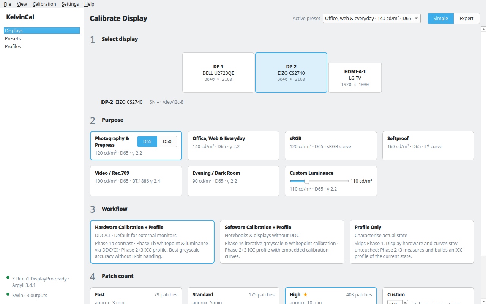
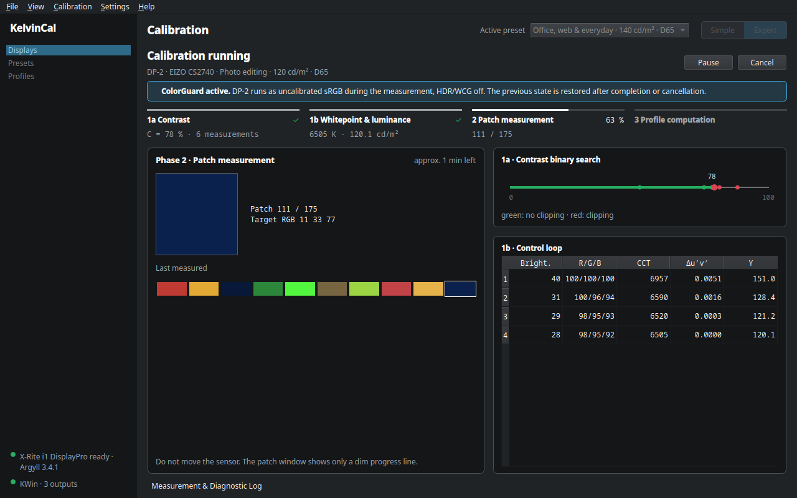
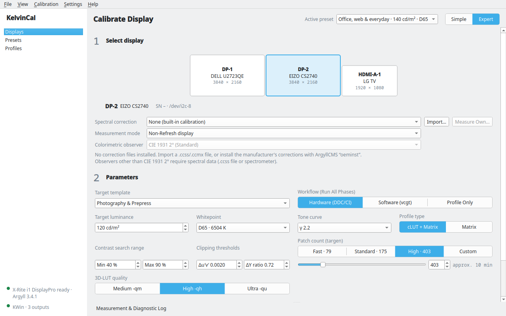
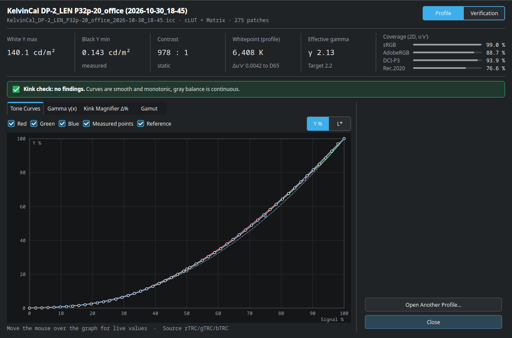
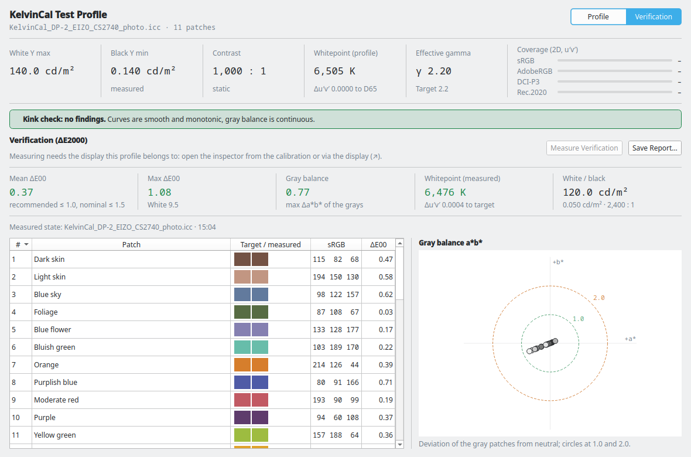
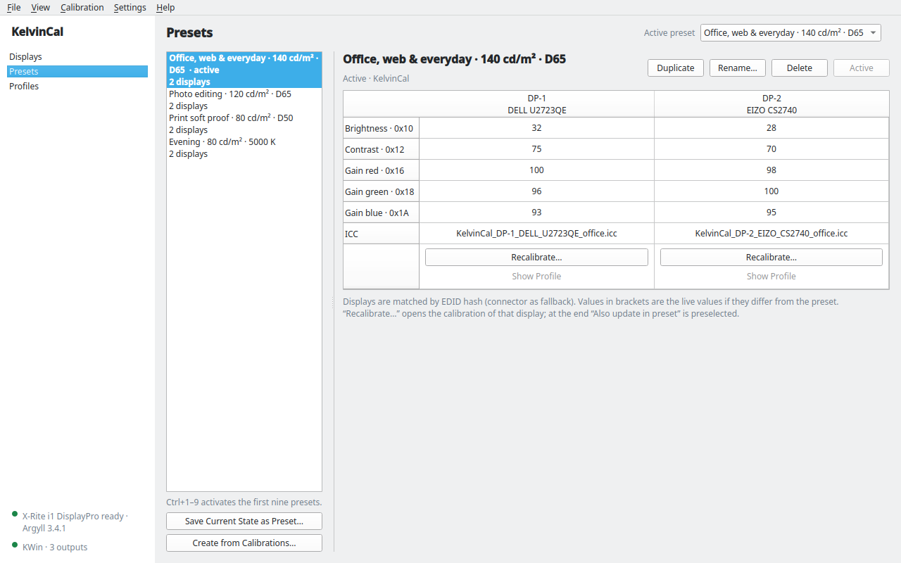
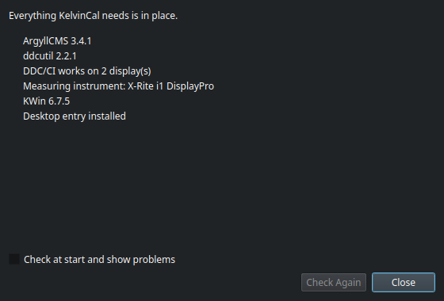
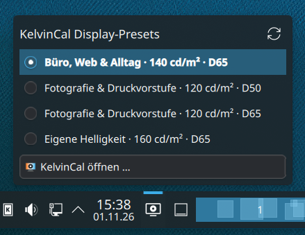

<p align="center"></p>

# KelvinCal

**Display calibration for KDE Plasma on Wayland: the display's own hardware is set to the target white point and
brightness over DDC/CI, then an ICC profile is measured with ArgyllCMS and activated in KWin. Presets switch all
displays at once, from the app, the panel or the command line.**



## What it does

- **Hardware first, software where needed.** Three calibration workflows cover every display:
  - **Hardware DDC/CI + Profile (recommended for external monitors):** KelvinCal finds the highest contrast setting
    that does not clip and adjusts the RGB gains and brightness of the display itself (DDC/CI) until white point and
    luminance match the target. Because white point and brightness are already set in the panel hardware without
    sacrificing 8-bit GPU LUT steps, the ICC profile applied by KWin across the Wayland desktop only has to describe
    the panel's native gamut and tone response (while the selected target tone curve serves as the inspector reference).
  - **Software calibration + Profile (for laptop panels and monitors without DDC/CI):** starts with an interactive
    live display adjustment (RGB balance and luminance bars on the patch window so you can set brightness or OSD
    controls manually), computes 1D video card gamma table (`vcgt`) curves with `dispcal`, applies them to the test
    patches (`dispread -K` via the 8-bit Wayland patch hook) and embeds the `vcgt` tag into the ICC profile for KWin.
  - **Profile only:** characterises the display in its current state without changing DDC registers or `vcgt` curves.
- **One run, sensor placed once.** Contrast search, white point/luminance control loop (or software 1D curves), patch
  measurement and profile computation run in one go. Four patch presets (*Fast* 79, *Standard* 175, *High* 403 or a
  custom count of 50–2000 patches) adapt their duration estimate to the connected sensor. Several targets (e.g.
  office, photo, evening) can be calibrated in one batch.
- **Made for Wayland and KWin.** The patch window opens fullscreen on the right display, KWin's colour management is
  switched to uncalibrated sRGB (with Night Light inhibited and any software dimming temporarily neutralised) during
  the measurement and restored afterwards, and the new profile is activated through KWin. Screen locking is inhibited
  while measuring.
- **Check before you keep it.** The inspector shows tone curves, effective gamma, `vcgt` status, gamut coverage and a
  kink check, lets you switch live between new profile, previous profile and uncalibrated, and verifies the result
  with ΔE2000 test patches against KWin's γ 2.2 or IEC sRGB reference curve (report as HTML).
- **Presets.** Brightness, contrast, RGB gains and ICC profile of all displays are stored together and switched in
  about a quarter of a second: in the app (Ctrl+1–9), with the Plasma panel widget or with `kelvincal-cli`.
  KelvinCal notices when a display no longer matches the active preset (e.g. changed in its on-screen menu).
- **Plasma integration.** Breeze style, follows the system colour scheme (or any installed one), notifications,
  D-Bus interface, single instance.
- **Colorimeter corrections, CIE 2015 observer & visual white point match.** Spectral corrections (.ccss) and
  matrices (.ccmx) per display, including your own measured with a spectrometer (i1 Pro, ColorMunki), plus optional
  CIE 2015 2° standard observer (`-Q 2015_2`, intentional perceptual alternative to the CIE 1931 ICC PCS convention)
  for wide-gamut LED and OLED panels. If two displays with different wide-gamut backlights still look slightly
  different at measured D65 (observer metamerism), the visual white point match adjusts one display to the other and
  stores the $xy$ offset per display.
- **Safe to interrupt.** Cancelling, quitting, logging out or even a crash leave no display in measurement state:
  the previous state is restored, or offered for restoring at the next start.

| | |
|---|---|
|  |  |
|  |  |
|  |  |

## Status

Beta. Developed and tested on Fedora 44 with KDE Plasma 6 (KWin 6.8), an X-Rite i1 Display Pro (colorimeter),
an i1 Pro (spectrometer) and Lenovo ThinkVision displays. Other instruments supported by ArgyllCMS and displays with
or without DDC/CI should work; reports are welcome.

Displays without DDC/CI (e.g. laptop panels) automatically default to the **Software calibration + Profile** workflow
(`vcgt` 1D LUT curves embedded in the ICC profile + interactive brightness/OSD adjustment).

## Requirements

- KDE Plasma 6 on Wayland (KWin, `kscreen-doctor`)
- Python ≥ 3.11 and PySide6 ≥ 6.6
- [ArgyllCMS](https://www.argyllcms.com/) for measuring
- [ddcutil](https://www.ddcutil.com/) and read/write access to `/dev/i2c-*` for DDC/CI
- A measuring instrument (colorimeter or spectrometer) [supported by ArgyllCMS](https://www.argyllcms.com/doc/instruments.html)

| | Fedora | openSUSE Tumbleweed | Debian / Ubuntu | Arch |
|---|---|---|---|---|
| Packages | `sudo dnf install python3-pyside6 argyllcms ddcutil libkscreen` | `sudo zypper install python3-pyside6 argyllcms ddcutil libkscreen6-plugin` | `sudo apt install python3-pyside6.qtwidgets python3-pyside6.qtdbus argyll ddcutil libkscreen-bin` | `sudo pacman -S pyside6 argyllcms ddcutil libkscreen` |

## Installation

Download the packages for your distribution from the [releases](https://github.com/colorcube/kelvincal/releases)
and install them with their dependencies (`kelvincal-plasmoid` is the panel widget):

```bash
sudo dnf install ./kelvincal-*.fc44.noarch.rpm                   # Fedora
sudo zypper install ./kelvincal-*.opensuse.noarch.rpm            # openSUSE Tumbleweed
sudo apt install ./kelvincal_*_all.deb ./kelvincal-plasmoid_*_all.deb   # Debian 13, Ubuntu with Plasma 6
kelvincal-cli check        # checks ArgyllCMS, ddcutil, I²C and USB access, KWin
```

After installing or updating the panel widget, restart Plasma once (`systemctl --user restart plasma-plasmashell`)
or log out and in.

To run it from a checkout instead:

```bash
git clone https://github.com/colorcube/kelvincal.git
cd kelvincal
./bin/install-plasmoid     # links kelvincal/kelvincal-cli into ~/.local/bin, installs desktop entry,
                           # icons, notifications and the panel widget (bin/install-desktop: without the widget)
```

Packages are built with `packaging/rpm/build.sh` (`--opensuse` for openSUSE) and `packaging/debian/build.sh` (in a container, podman or docker).

The setup check (also *Help → Check Setup…* in the app) names every missing piece together with the command that
fixes it, e.g. access to the I²C buses or a udev rule for the instrument.

## Usage

Start **KelvinCal** from the application menu (or `kelvincal`).

1. **Simple mode:** select the display (1), choose the purpose (2: photo, office, sRGB, soft proof, video, evening or
   custom brightness), pick the calibration workflow (3: Hardware DDC/CI, Software calibration `vcgt`, or Profile only)
   and patch count preset (4: Fast 79, Standard 175, High 403 or Custom), then start the calibration. Place the sensor
   in the crosshair when asked; the rest runs by itself.
2. **Inspector:** check the new profile, switch between new and previous profile, optionally verify it, then save
   it. It is activated in KWin and can be stored in a preset right away.
3. **Expert mode:** configure workflow, tone curve ($\gamma$, sRGB, BT.1886, $L^*$), CIE observer (1931 2° or 2015 2°),
   patch count, profile quality, colorimeter correction and measurement mode, or run the phases one by one
   (1a contrast, 1b white point and luminance, 1s software calibration, 2+3 patches and profile).

Add the **KelvinCal** widget to the panel to switch presets with one click.



### Command line

```bash
kelvincal-cli status                       # displays, DDC values, active ICC profiles
kelvincal-cli list-presets
kelvincal-cli apply-preset "Photo editing · 120 cd/m² · D65"
kelvincal-cli capture-preset "Current setup"
kelvincal-cli batch -c DP-2 -t office,photo,evening   # calibrate several targets, sensor placed once
kelvincal-cli batch -c eDP-1 -t office --workflow software --patches standard --observer 2015_2
kelvincal-cli software-calibrate -c eDP-1 --luminance 120   # standalone Phase 1s (.cal 1D curves)
kelvincal-cli verify -c DP-2 -o verification.html     # ΔE2000 verification of the active profile
kelvincal-cli make-ccss -c DP-2            # own colorimeter correction, measured with a spectrometer
kelvincal-cli diag                         # colour state snapshot for bug reports
kelvincal-cli recover                      # restore displays after an interrupted measurement
```

`kelvincal-cli --help` and `kelvincal-cli <command> --help` list all options.

## How the calibration works

| Phase | What happens |
|---|---|
| 1a Contrast *(DDC workflow)* | Binary search for the highest DDC contrast at which near-white steps stay distinguishable and no channel clips (luminance step and Δu′v′ of 248 vs. 255) |
| 1b White point & luminance *(DDC workflow)* | Control loop over the RGB gains (the strongest channel stays at 100) and brightness until white is within Δu′v′ 0.0015 (fine: 0.0005) and 1.5 cd/m² of the target, followed by final clipping check (1c) |
| 1s Software calibration *(Software workflow)* | Live interactive display adjustment (RGB balance and luminance target bars) followed by `dispcal` 1D LUT curve measurement (`.cal`) for white point and tone response |
| 2 Patches | `targen` + `dispread` (with `-k <file>.cal` in software workflow) measure gray ramp, cube and optimised spread patches through KelvinCal's own Wayland patch window |
| 3 Profile | `colprof` computes the ICC profile (cLUT, shaper+matrix or matrix, selectable, embedding the `vcgt` tag when `.cal` curves are present); the measurements are checked for outliers first and a poor fit is reported as a warning |

In the hardware DDC workflow, the white point is set in the display itself, so the profile's own white needs (almost)
no correction. In the software workflow, 1D `vcgt` curves embedded in the ICC profile calibrate white point and grey
axis through KWin. KelvinCal stores the DDC values, workflow, observer, `vcgt` status and patch count next to each
profile (`.kelvincal.json`), so presets and the inspector can restore and display the matching state.

## Development

```bash
PYTHONPATH=packages python3 -m unittest discover -s tests   # tests (run offscreen, no hardware needed)
./bin/update-translations                                    # .ts/.qm after changing UI strings (qt6-linguist)
tools/screenshots.py                                         # regenerate docs/images from the real widgets
```

The code lives in `packages/kelvincal/`: `core` (models, colorimetry, display discovery, compositor backends,
verification), `ddc` (DDC/CI client, contrast and white point optimizers), `argyll` (spotread session, profiling
pipeline, profile inspection, corrections), `presets` and `gui` (Qt GUI, CLI, D-Bus). The source language is
English; translations are Qt Linguist files in `packages/kelvincal/gui/i18n/` (German is complete). The GUI follows
the system language, `KELVINCAL_LANG=en|de` overrides it.

## Roadmap

- A manual (English and German)
- GNOME/Mutter backend (profiles via `org.gnome.Mutter.DisplayConfig` and colord)
- Gamut viewer (CIE xy/u′v′, 3D volume)

## About the development

KelvinCal was developed with extensive help from AI. The code, the tests and the documentation were written by Google's Gemini and Anthropic's Claude under my direction. Requirements, design decisions, review and all tests with real displays and measuring instruments are my own.

## License

GNU General Public License v3.0 or later, see [LICENSE](LICENSE). KelvinCal runs the ArgyllCMS tools (AGPL) as separate programs and contains no
ArgyllCMS code.
